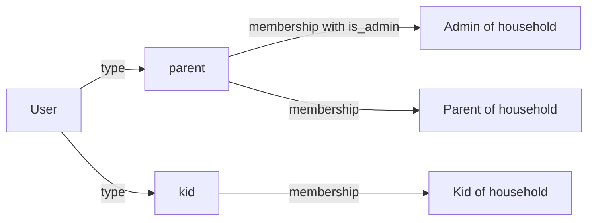
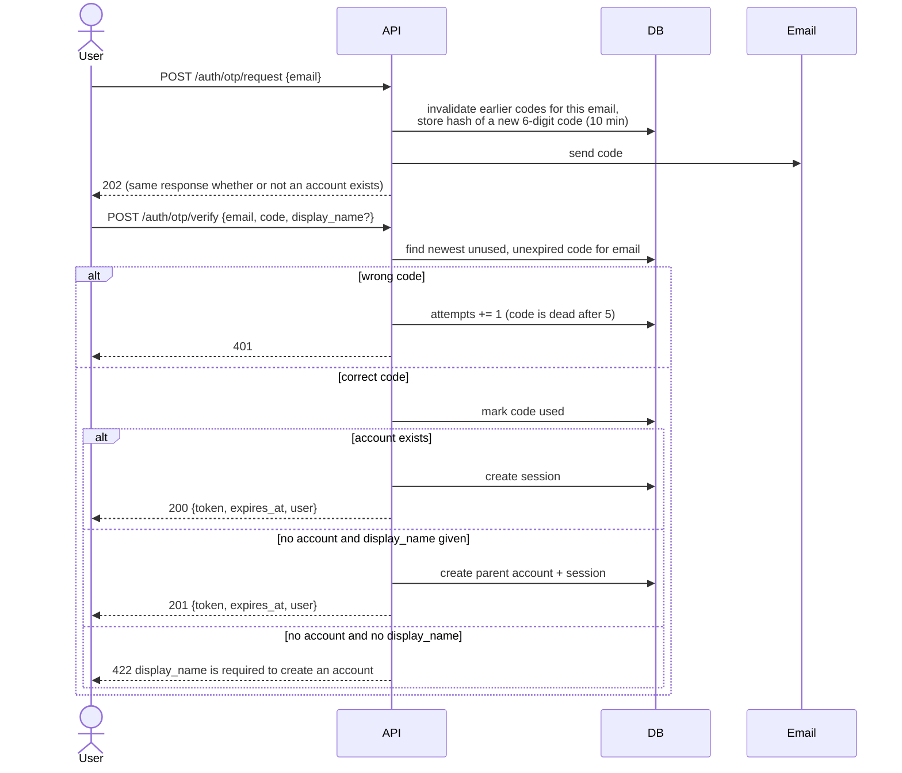
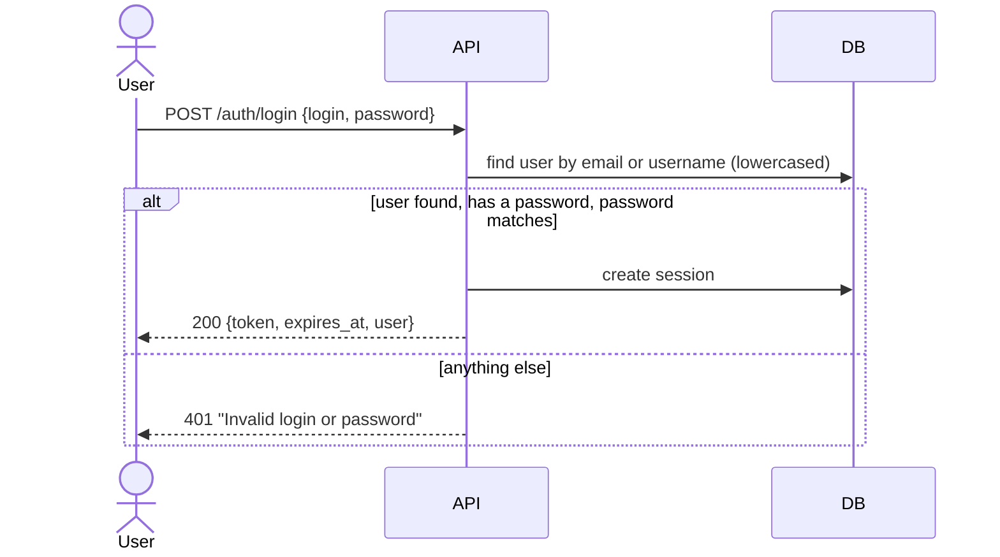
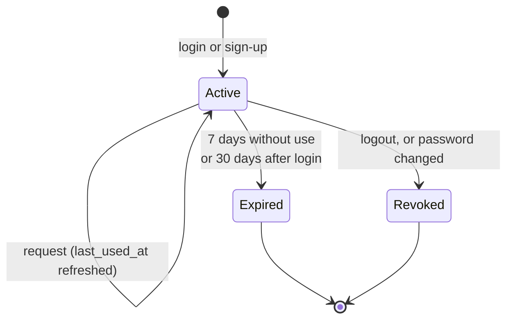
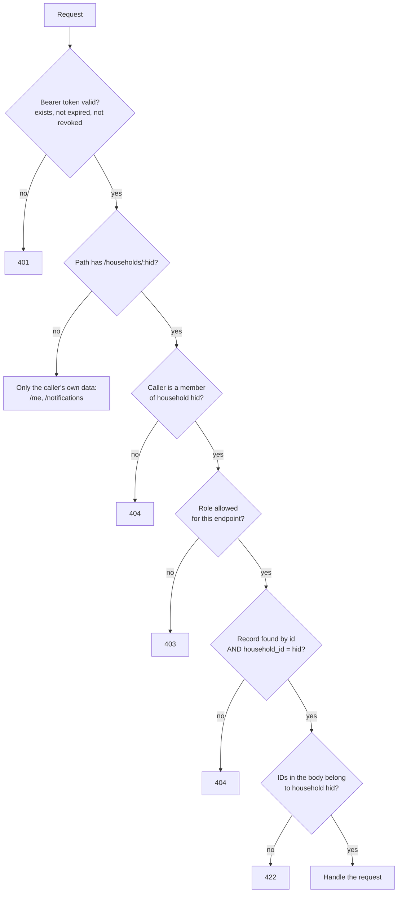
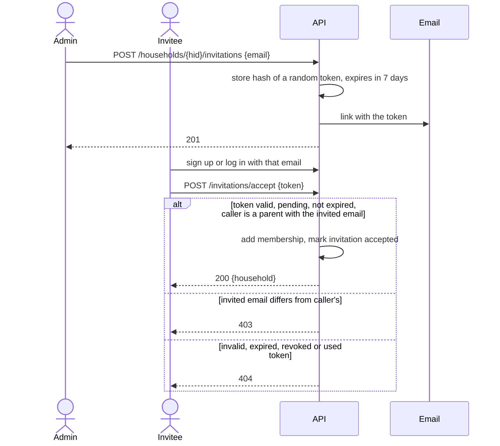
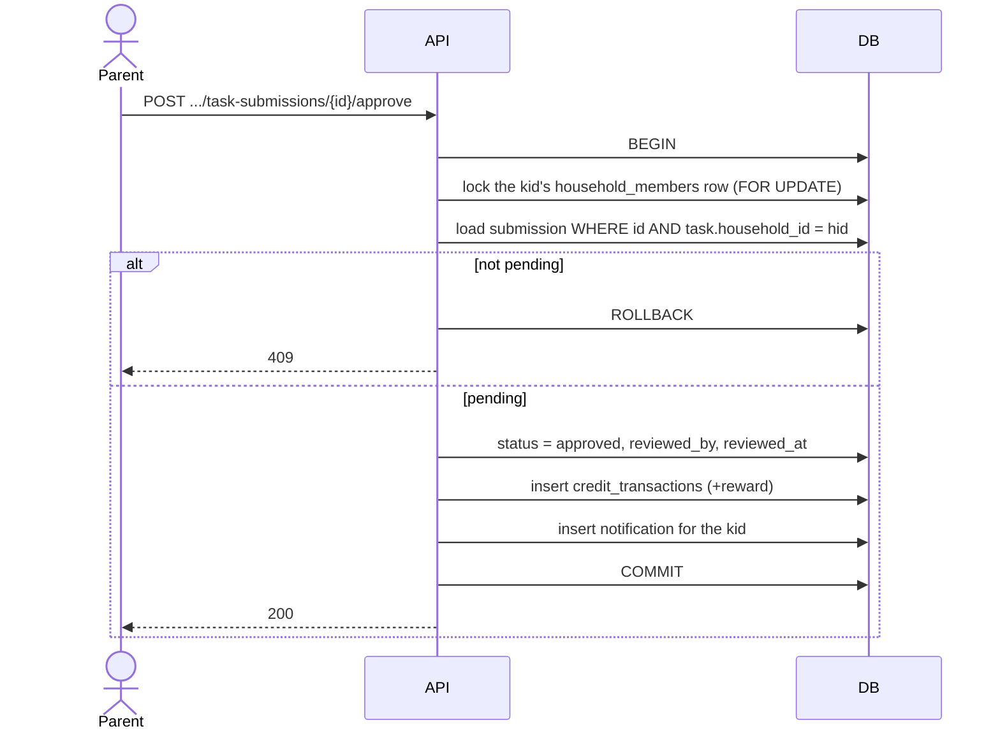

# API

This document describes the Capycoin backend API: how users sign up and log in, how sessions work, who can do what, and every endpoint for the parents' features. The data model behind it is in [database.md](database.md).

**Status:** the API is being built in steps. Only `GET /health` exists today. Everything else in this document is the agreed design; update the status column as endpoints are implemented.

## Conventions

- **Base URL:** the backend root, for example `http://localhost:8000` in development.
- **Format:** JSON request and response bodies.
- **Authentication:** every endpoint except the public auth endpoints needs an `Authorization: Bearer <session token>` header.
- **IDs:** UUIDs (version 7, ordered by creation time).
- **Times:** ISO 8601 with a timezone, for example `2026-11-10T09:30:00Z`.
- **Pagination:** list endpoints that can grow return `{"items": [...], "next_before": "<id or null>"}`. Pass `?before=<next_before>&limit=<n>` to get the next page. `limit` defaults to 50, maximum 100.
- **Errors:** `{"detail": "<message>"}`, with these status codes:

| Status | Meaning |
|---|---|
| 401 | Not logged in, or the session is expired or revoked. |
| 403 | Logged in and allowed to see the resource, but the role is not enough (for example a non-admin parent inviting someone). |
| 404 | Not found, **or no access**. Records in households the user does not belong to always return 404, so their existence is never revealed. |
| 409 | The request conflicts with the current state (for example approving a request that was already reviewed). |
| 422 | Invalid input, including IDs in the body that do not belong to the household. |
| 429 | Too many attempts. Try again later. |

## Roles

A user has one account **type** (`parent` or `kid`) and a **membership** in each household they belong to. A parent can be the **admin** of a household; each household has exactly one admin, normally the parent who created it.

Permissions depend on the role **in the household of the request**. A parent who is admin of one household and a plain parent in another has admin rights only in the first.

### Permissions

| Action | Admin | Parent | Kid | Not a member |
|---|:-:|:-:|:-:|:-:|
| View household | ✅ | ✅ | ✅ | 404 |
| Edit household name and timezone | ✅ | ✅ | 403 | 404 |
| Delete household | ✅ | 403 | 403 | 404 |
| View members | ✅ | ✅ | 403 | 404 |
| Invite or uninvite parents, remove a parent | ✅ | 403 | 403 | 404 |
| Create, edit or delete kid accounts | ✅ | 403 | 403 | 404 |
| View kids, balances and transaction history | ✅ | ✅ | 403 | 404 |
| Add or remove credits | ✅ | ✅ | 403 | 404 |
| Manage tasks | ✅ | ✅ | 403 | 404 |
| Manage prizes | ✅ | ✅ | 403 | 404 |
| Approve or deny task submissions and prize claims | ✅ | ✅ | 403 | 404 |
| Own account, notifications and notification settings | ✅ | ✅ | ✅ | n/a |

Kid endpoints (seeing their tasks, submitting, claiming prizes) are not part of this document yet.

## Authentication

There are two ways to log in. Both end with a **session token**.

1. **One-time code by email.** Parents always have an email; kids may have one. This is also how parents sign up, which proves they own the email address.
2. **Username or email plus password.** Kids without email use this. Parents can set a password in their settings and then use it too.

### Sign-up and login with a code

Rules:

- Codes are 6 digits, valid for 10 minutes, usable once, and dead after 5 wrong attempts. Only a hash of the code is stored, and codes are compared in constant time.
- Requesting a new code invalidates earlier unused codes for that email.
- An email can request at most 3 codes per 15 minutes; more requests get 429.
- `POST /auth/otp/request` never reveals whether an account exists.
- Sign-up always creates a **parent**. Kid accounts are only created by a household admin.

### Login with a password

- `login` is an email or a username. Both are matched in lowercase.
- Every failure gives the same 401 message, so it does not reveal which accounts exist or which ones have a password.
- Passwords are hashed with Argon2 (`pwdlib`). They must be 8 to 128 characters.
- Repeated failures are rate limited per login and per IP address (429).

### Sessions

A session is a row in the `sessions` table. The client receives a random token (32 bytes, URL-safe). The database stores only its SHA-256 hash, so a database leak does not expose usable tokens.

- **Lifetime:** a session expires 30 days after login, or after 7 days without use, whichever comes first. `last_used_at` is refreshed at most every 5 minutes, so most requests do not write to the database.
- **Logout** revokes the current session.
- **Changing the password** revokes all other sessions of that user.
- **Deleting a user** deletes their sessions.
- Database sessions were chosen over JWTs because every request already reads the database to check household membership, so JWTs would save nothing, and they cannot be revoked immediately.

### Checking access on every request

How this is built, and what every new endpoint must follow:

1. `get_current_user` reads the bearer token and loads the user, or returns 401.
2. Household routers are mounted under `/households/{household_id}` with a router-level dependency that loads the caller's membership. It runs for every endpoint in the router, so an endpoint cannot skip it.
3. Role checks (`require_parent`, `require_admin`) build on that membership.
4. Records are always loaded with the household in the query, for example `WHERE tasks.id = :id AND tasks.household_id = :household_id`. Submissions and claims are joined to their task or prize to check the household. Never load a record by id alone and check afterwards.
5. IDs in request bodies (such as `kid_ids`) are checked against the household's members too.
6. Endpoints outside households (`/me`, `/notifications`) always filter by the caller's own user id.
7. Responses use explicit Pydantic response models, never ORM objects, so hashes and internal fields cannot leak.
8. Tests: a table lists every route with the roles allowed to call it. One parametrized test calls each route as an anonymous user, a parent of another household, a kid, a non-admin parent, and with record ids from another household, and checks the status codes above. Another test fails if any route is missing from that table.

### Database access from outside the backend

Supabase publishes tables in the `public` schema through its REST API. The backend is the only client of the database, so a migration enables Row Level Security on every table, with no policies, and removes access for Supabase's `anon` and `authenticated` roles. The backend connects as the owner of the tables, which RLS does not apply to. A test fails if any table is missing RLS, so new tables cannot be published by accident.

### Email

Emails (codes and invitations) go through the `EmailSender` interface in `app-backend/core/email/`. The backend is chosen by the `email_backend` setting. Today the only backend is `console`, which prints emails to the server output. A real provider will be a new module next to `console.py`; the console backend can then be removed without touching the code that sends emails.

## Endpoints

`{hid}` is a household id. "Parent" includes the admin.

### Auth

| Method | Path | Who | Status |
|---|---|---|---|
| POST | `/auth/otp/request` | anyone | planned |
| POST | `/auth/otp/verify` | anyone | planned |
| POST | `/auth/login` | anyone | planned |
| POST | `/auth/logout` | logged in | planned |

- `POST /auth/otp/request` `{email}` → `202`.
- `POST /auth/otp/verify` `{email, code, display_name?}` → `200` (login) or `201` (new parent account) with `{token, expires_at, user}`. `401` for a wrong or expired code, `422` if the account does not exist and `display_name` is missing.
- `POST /auth/login` `{login, password}` → `200 {token, expires_at, user}` or `401`.
- `POST /auth/logout` → `204`. Revokes the current session.

### My account

| Method | Path | Who | Status |
|---|---|---|---|
| GET | `/me` | logged in | planned |
| PATCH | `/me` | logged in | planned |
| PUT | `/me/password` | logged in | planned |
| GET | `/me/households` | logged in | planned |
| GET | `/me/notification-preferences` | logged in | planned |
| PUT | `/me/notification-preferences` | logged in | planned |

- `PATCH /me` `{display_name?, username?}`. `409` if the username is taken. Changing the email is not supported yet.
- `PUT /me/password` `{current_password?, new_password}` → `204`. `current_password` is required when a password is already set. Revokes the user's other sessions.
- `GET /me/households` → the households the user belongs to, with their role and whether they are admin.
- `GET /me/notification-preferences` → every notification type and channel with its effective `enabled` value (defaults included). `PUT` takes `{preferences: [{type, channel, enabled}]}`.

### Households and members

| Method | Path | Who | Status |
|---|---|---|---|
| POST | `/households` | parent account | planned |
| GET | `/households/{hid}` | member | planned |
| PATCH | `/households/{hid}` | parent | planned |
| DELETE | `/households/{hid}` | admin | planned |
| GET | `/households/{hid}/members` | parent | planned |
| DELETE | `/households/{hid}/members/{user_id}` | admin | planned |

- `POST /households` `{name, timezone}` → `201`. The caller becomes the admin. `timezone` must be a valid IANA name such as `Europe/Stockholm`.
- `PATCH /households/{hid}` `{name?, timezone?}`.
- `DELETE /households/{hid}` `{confirm_name}` → `204`. `confirm_name` must equal the household name. Deletes everything in the household (see database.md).
- `DELETE /households/{hid}/members/{user_id}` removes a **parent** from the household. The admin cannot remove themselves (`409`). Kids are removed through the kid endpoints.

### Invitations

| Method | Path | Who | Status |
|---|---|---|---|
| GET | `/households/{hid}/invitations` | admin | planned |
| POST | `/households/{hid}/invitations` | admin | planned |
| DELETE | `/households/{hid}/invitations/{invitation_id}` | admin | planned |
| POST | `/invitations/accept` | logged-in parent | planned |

- `POST` `{email}` → `201`. `409` if that email already has a pending invitation or belongs to a member.
- `GET` lists pending invitations. `DELETE` revokes a pending one (`204`).
- Only the user whose email matches the invitation can accept it. Parents' emails are always verified, because parents sign up with a one-time code.

### Kids and wallet

| Method | Path | Who | Status |
|---|---|---|---|
| GET | `/households/{hid}/kids` | parent | planned |
| POST | `/households/{hid}/kids` | admin | planned |
| GET | `/households/{hid}/kids/{kid_id}` | parent | planned |
| PATCH | `/households/{hid}/kids/{kid_id}` | admin | planned |
| DELETE | `/households/{hid}/kids/{kid_id}` | admin | planned |
| GET | `/households/{hid}/kids/{kid_id}/transactions` | parent | planned |
| POST | `/households/{hid}/kids/{kid_id}/adjustments` | parent | planned |

- `POST /kids` `{display_name, username?, password?, email?}` → `201`. A kid needs an email, or a username and a password. `409` if the username or email is taken.
- `GET /kids` and `GET /kids/{kid_id}` include `balance`, `reserved` (pending prize claims) and `available` (`balance - reserved`) for this household.
- `PATCH /kids/{kid_id}` `{display_name?, username?, email?, password?}`. Setting `password` revokes the kid's sessions.
- `DELETE /kids/{kid_id}` → `204`. Removes the kid from this household, with their tasks, claims and credits here. The account itself is deleted only if the kid belongs to no other household.
- `GET /transactions` → paginated credit log, newest first, with the linked task or prize name.
- `POST /adjustments` `{amount, note}` → `201`. `amount` is a non-zero integer, positive to add and negative to remove credits. A balance may go negative. The kid gets a notification.

### Tasks

| Method | Path | Who | Status |
|---|---|---|---|
| GET | `/households/{hid}/tasks` | parent | planned |
| POST | `/households/{hid}/tasks` | parent | planned |
| GET | `/households/{hid}/tasks/{task_id}` | parent | planned |
| PATCH | `/households/{hid}/tasks/{task_id}` | parent | planned |
| DELETE | `/households/{hid}/tasks/{task_id}` | parent | planned |

- `POST` `{title, description?, reward, recurrence, starts_on, due_at?, kid_ids}` → `201`. `reward > 0`. `recurrence` is `none`, `daily`, `weekly` or `monthly`. For one-off tasks `due_at` is the deadline; for recurring tasks it is when they stop repeating. Every id in `kid_ids` must be a kid of this household (`422` otherwise).
- `GET` list filters: `?kid_id=`, `?archived=true|false` (default `false`).
- `PATCH` takes the same fields, all optional. `kid_ids` replaces the assignment list. A new `reward` applies to submissions approved after the change.
- `DELETE` archives the task (`204`). Archived tasks are hidden from kids; their pending submissions can still be reviewed.

### Prizes

| Method | Path | Who | Status |
|---|---|---|---|
| GET | `/households/{hid}/prizes` | parent | planned |
| POST | `/households/{hid}/prizes` | parent | planned |
| GET | `/households/{hid}/prizes/{prize_id}` | parent | planned |
| PATCH | `/households/{hid}/prizes/{prize_id}` | parent | planned |
| DELETE | `/households/{hid}/prizes/{prize_id}` | parent | planned |

- `POST` `{name, description?, cost}` → `201`. `cost > 0`.
- `PATCH` takes the same fields, all optional. A new `cost` does not change pending claims, which keep the cost from when they were made.
- `DELETE` archives the prize (`204`). Pending claims can still be reviewed.

### Approvals

| Method | Path | Who | Status |
|---|---|---|---|
| GET | `/households/{hid}/task-submissions` | parent | planned |
| GET | `/households/{hid}/task-submissions/{submission_id}` | parent | planned |
| POST | `/households/{hid}/task-submissions/{submission_id}/approve` | parent | planned |
| POST | `/households/{hid}/task-submissions/{submission_id}/deny` | parent | planned |
| GET | `/households/{hid}/prize-claims` | parent | planned |
| GET | `/households/{hid}/prize-claims/{claim_id}` | parent | planned |
| POST | `/households/{hid}/prize-claims/{claim_id}/approve` | parent | planned |
| POST | `/households/{hid}/prize-claims/{claim_id}/deny` | parent | planned |

- Lists filter by `?status=pending|approved|denied` (default `pending`) and `?kid_id=`, and are paginated.
- `approve` and `deny` take `{note?}` and return the updated request. `409` if it is no longer pending.
- A task approval credits the task's current `reward`. A prize approval debits the claim's `cost` and needs the kid's balance, minus their other pending claims, to cover it (`409` otherwise).

The lock on the kid's membership row makes concurrent approvals and claims for the same kid run one after another, so two requests cannot spend the same credits.

### Notifications

| Method | Path | Who | Status |
|---|---|---|---|
| GET | `/notifications` | logged in | planned |
| GET | `/notifications/{notification_id}` | recipient | planned |
| POST | `/notifications/{notification_id}/read` | recipient | planned |
| POST | `/notifications/read-all` | logged in | planned |

- `GET /notifications` filters: `?household_id=`, `?unread=true`. Paginated, newest first. Only the caller's own notifications, from households they still belong to.
- `GET /notifications/{id}` includes a summary of what it is about (the submission, claim or credit change). `404` for anyone but the recipient.
- `POST /notifications/read-all` takes an optional `{household_id}`.

Parents get `task_submitted` and `prize_claimed`. Kids get `task_approved`, `task_denied`, `prize_claim_approved`, `prize_claim_denied` and `credits_adjusted`. A notification is created only when the recipient has not turned off its `in_app` channel.

### Health

| Method | Path | Who | Status |
|---|---|---|---|
| GET | `/health` | anyone | implemented |

Returns `{"status": "ok"}` when the API can reach the database.

## Not covered yet

- Kid endpoints: seeing tasks, submitting with a photo, claiming prizes, wallet and notifications.
- Photo upload and signed links to view photos.
- Changing a user's email address.
- Adding an existing kid to a second household.
- Transferring the admin role.
- Email delivery through a real provider.
