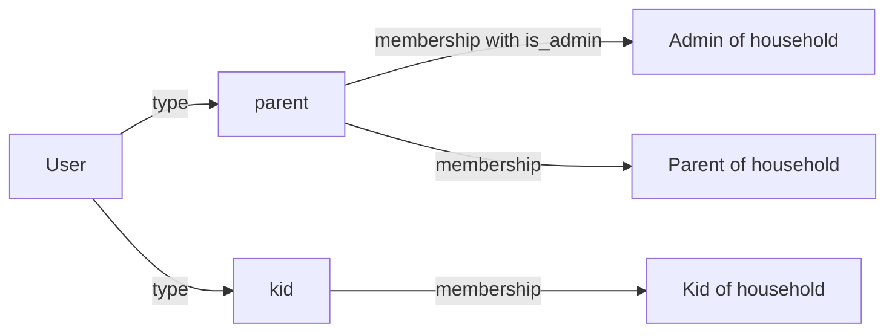
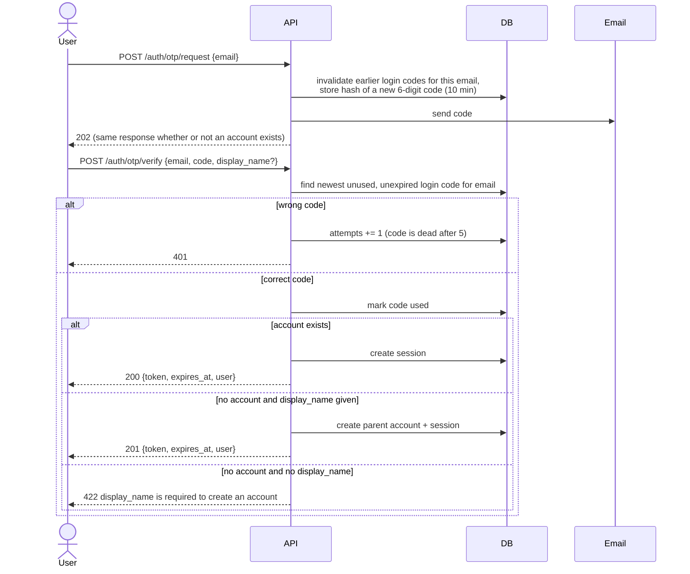
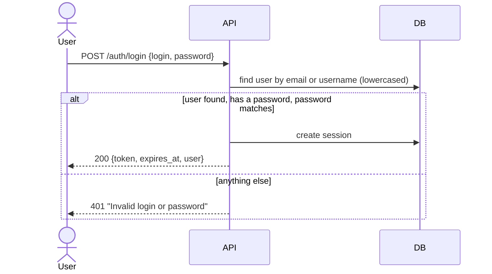
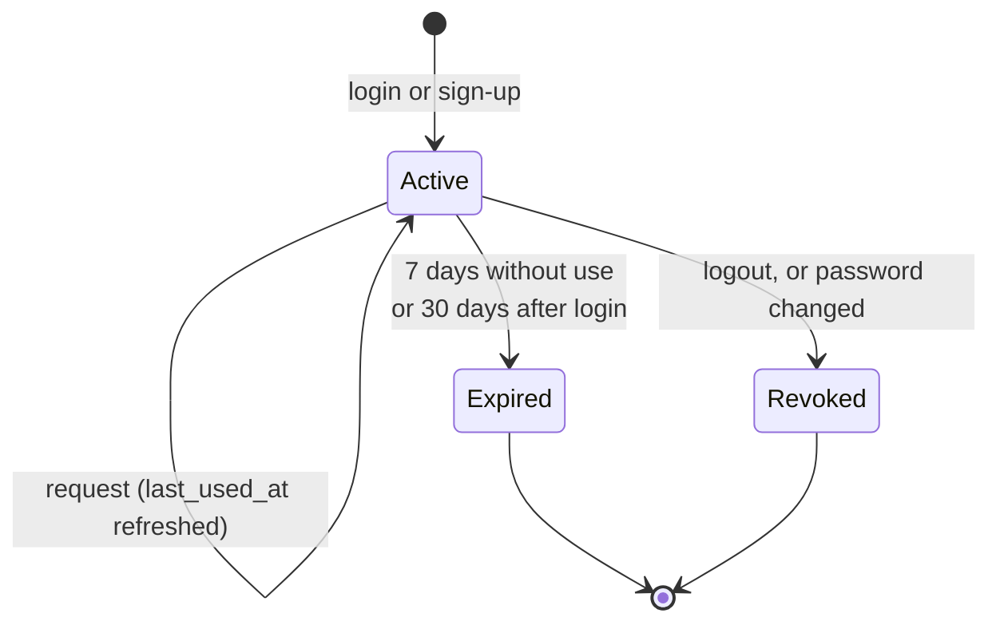
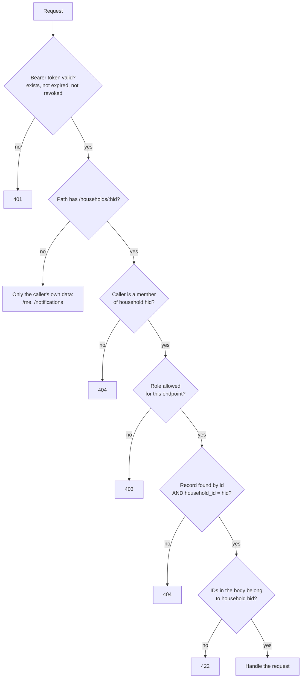
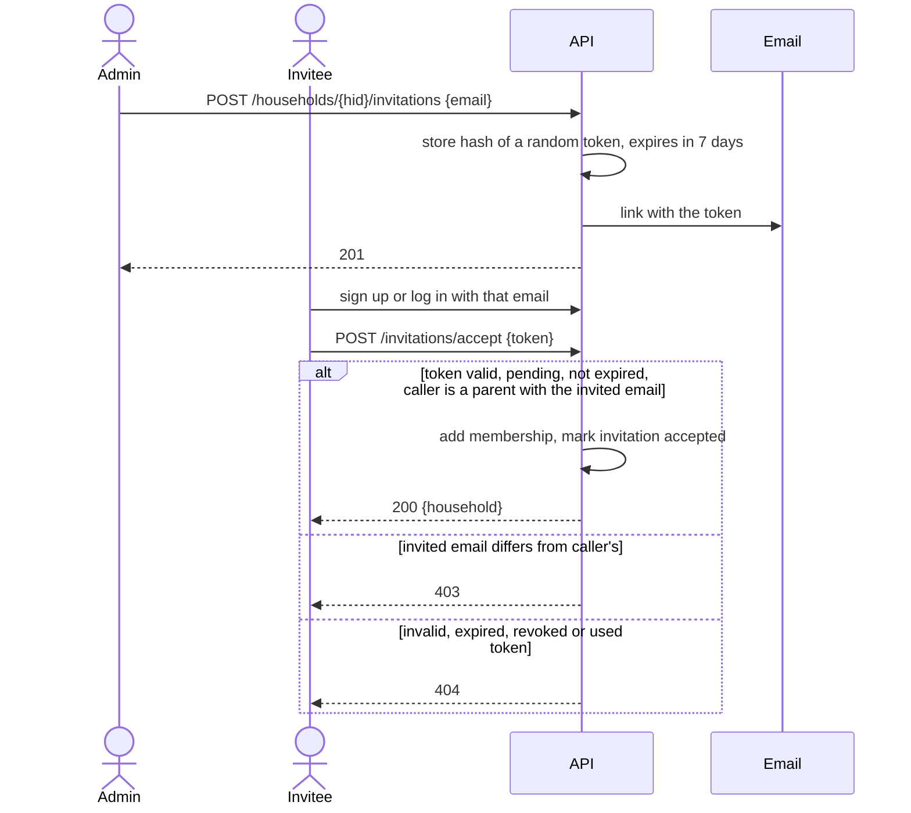
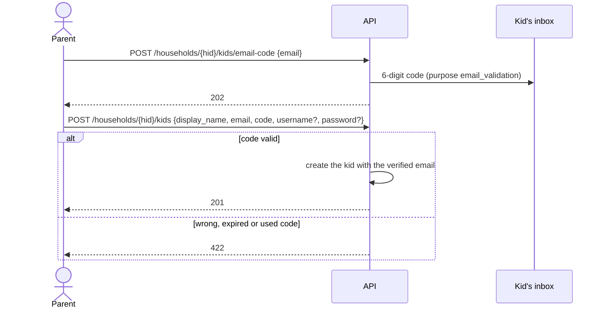
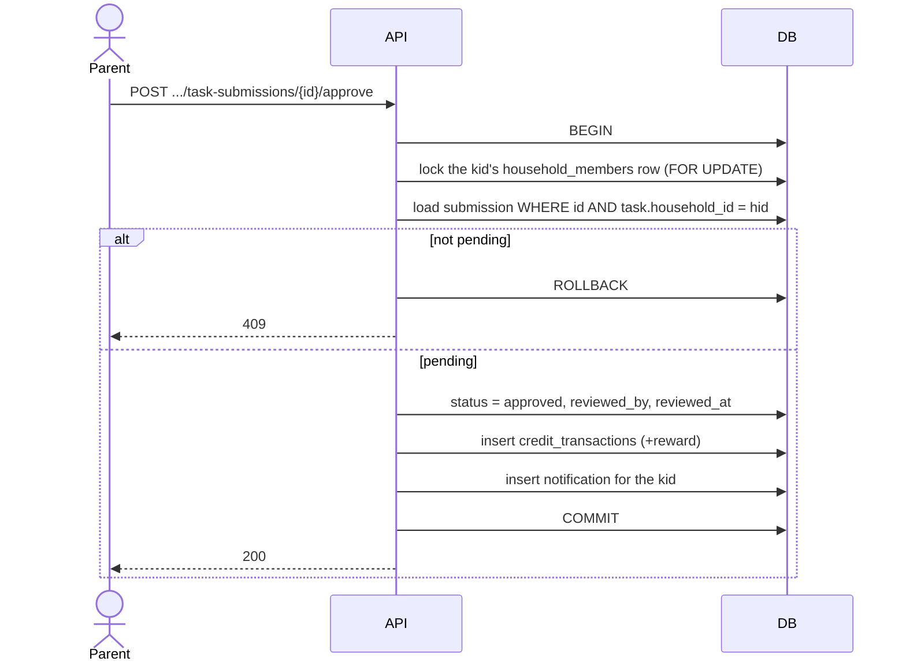
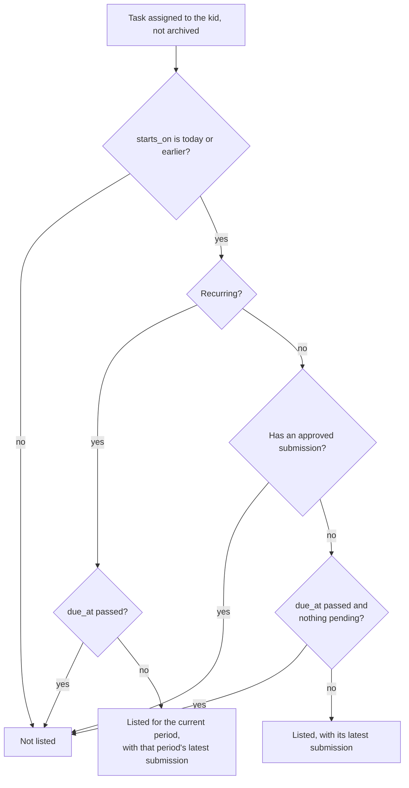
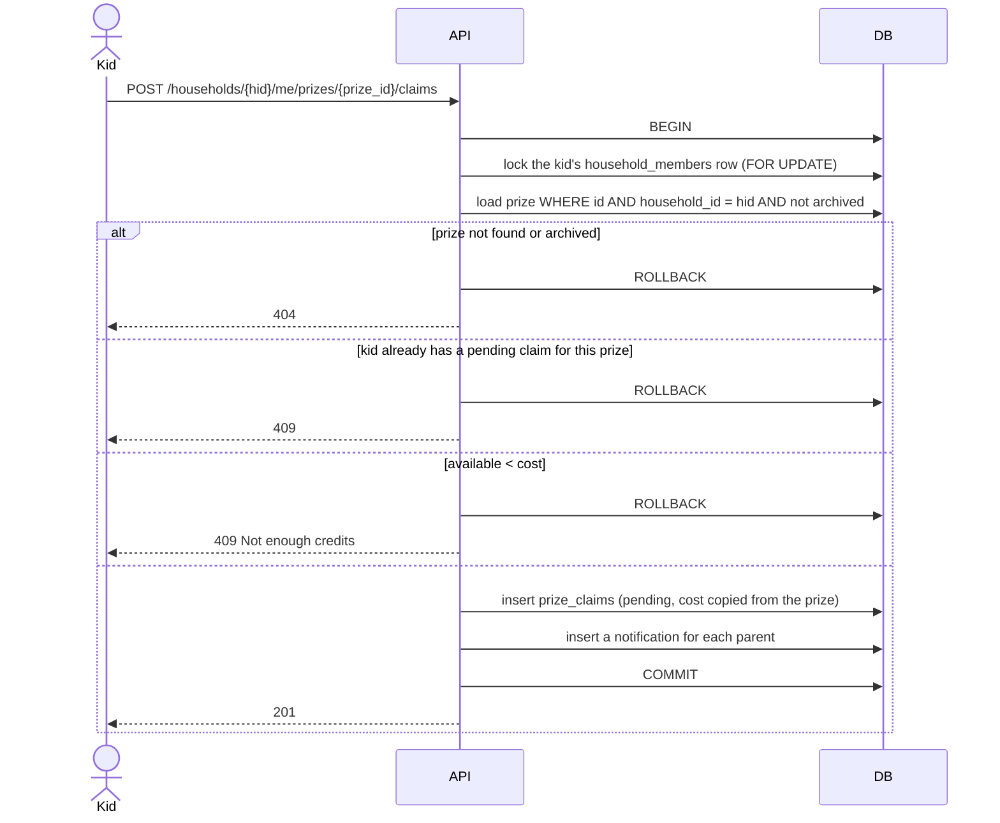

# API

This document describes the Capycoin backend API: how users sign up and log in, how sessions work, who can do what, and every endpoint for the parents' and kids' features. The data model behind it is in [database.md](database.md).

**Status:** the API is being built in steps. The status column of each endpoint table says what exists today. Everything else in this document is the agreed design; update the status column as endpoints are implemented.

## Conventions

- **Base URL:** the backend root, for example `http://localhost:8000` in development.
- **Format:** JSON request and response bodies, except a kid's task submission, which is `multipart/form-data` so it can carry a photo.
- **Authentication:** every endpoint except the public auth endpoints needs an `Authorization: Bearer <session token>` header.
- **IDs:** UUIDs (version 7, ordered by creation time).
- **Times:** moments are ISO 8601 in UTC, for example `2026-11-10T09:30:00Z`; requests must include an offset (`Z` or `+01:00`), or get `422`. Calendar days (such as a task's `starts_on`) are `YYYY-MM-DD` in the household's timezone. See [Times and dates](database.md#times-and-dates).
- **Pagination:** list endpoints that can grow return `{"items": [...], "next_before": "<id or null>"}`. Pass `?before=<next_before>&limit=<n>` to get the next page. `limit` defaults to 50, maximum 100.
- **Errors:** `{"detail": "<message>"}`, with these status codes:

| Status | Meaning |
|---|---|
| 401 | Not logged in, or the session is expired or revoked. |
| 403 | Logged in and allowed to see the resource, but the role is not enough (for example a non-admin parent inviting someone). |
| 404 | Not found, **or no access**. Records in households the user does not belong to always return 404, so their existence is never revealed. |
| 409 | The request conflicts with the current state (for example approving a request that was already reviewed). |
| 422 | Invalid input, including IDs in the body that do not belong to the household. |
| 429 | Too many attempts. Try again later. |

## Roles

A user has one account **type** (`parent` or `kid`) and a **membership** in each household they belong to. A parent can be the **admin** of a household; each household has exactly one admin, normally the parent who created it.

Permissions depend on the role **in the household of the request**. A parent who is admin of one household and a plain parent in another has admin rights only in the first.

### Permissions

| Action | Admin | Parent | Kid | Not a member |
|---|:-:|:-:|:-:|:-:|
| View household | ✅ | ✅ | ✅ | 404 |
| Edit household name and timezone | ✅ | ✅ | 403 | 404 |
| Delete household | ✅ | 403 | 403 | 404 |
| View members | ✅ | ✅ | 403 | 404 |
| Invite or uninvite parents, remove a parent | ✅ | 403 | 403 | 404 |
| Create, edit or delete kid accounts | ✅ | 403 | 403 | 404 |
| View kids, balances and transaction history | ✅ | ✅ | 403 | 404 |
| Add or remove credits | ✅ | ✅ | 403 | 404 |
| Manage tasks | ✅ | ✅ | 403 | 404 |
| Manage prizes | ✅ | ✅ | 403 | 404 |
| Approve or deny task submissions and prize claims | ✅ | ✅ | 403 | 404 |
| Own account, notifications and notification settings | ✅ | ✅ | ✅ | n/a |
| See own tasks and mark them done | 403 | 403 | ✅ | 404 |
| See the prize store and claim prizes | 403 | 403 | ✅ | 404 |
| See own wallet, history and claims | 403 | 403 | ✅ | 404 |

Kids use their own endpoints under `/households/{hid}/me/` (see [Kid app](#kid-app)), never the parents' ones with a filter. A kid's responses then cannot carry other kids' data by mistake, and the access table keeps one rule per route.

## Authentication

There are two ways to log in. Both end with a **session token**.

1. **One-time code by email.** Parents always have an email; kids may have one. This is also how parents sign up, which proves they own the email address.
2. **Username or email plus password.** Kids without email use this. Parents can set a password in their settings and then use it too.

### Sign-up and login with a code

Rules:

- Codes are 6 digits, valid for 10 minutes, usable once, and dead after 5 wrong attempts. Only a hash of the code is stored, and codes are compared in constant time.
- Every code has a **purpose**: `login` (sent by `POST /auth/otp/request`) or `email_validation` (sent when a parent adds an email to a kid's account). A code works only for the purpose it was sent for, so a code from one email can't be used for the other action.
- Requesting a new code invalidates earlier unused codes for that email and purpose.
- An email can receive at most 3 codes per 15 minutes, counting every purpose; more requests get 429.
- `POST /auth/otp/request` never reveals whether an account exists.
- Sign-up always creates a **parent**. Kid accounts are only created by a household admin.

### Login with a password

- `login` is an email or a username. Both are matched in lowercase.
- Every failure gives the same 401 message, so it does not reveal which accounts exist or which ones have a password.
- Passwords are hashed with Argon2 (`pwdlib`). They must be 8 to 128 characters.
- Repeated failures are rate limited per login and per IP address (429). See [Rate limits](#rate-limits).

### Sessions

A session is a row in the `sessions` table. The client receives a random token (32 bytes, URL-safe). The database stores only its SHA-256 hash, so a database leak does not expose usable tokens.

- **Lifetime:** a session expires 30 days after login, or after 7 days without use, whichever comes first. `last_used_at` is refreshed at most every 5 minutes, so most requests do not write to the database.
- **Logout** revokes the current session.
- **Changing the password** revokes all other sessions of that user.
- **Deleting a user** deletes their sessions.
- Database sessions were chosen over JWTs because every request already reads the database to check household membership, so JWTs would save nothing, and they cannot be revoked immediately.

### Checking access on every request

How this is built, and what every new endpoint must follow:

1. `get_current_user` reads the bearer token and loads the user, or returns 401.
2. Household routers are created with `household_router()` from `api/deps.py`. It mounts them under `/households/{household_id}` with a router-level dependency (`get_membership`) that loads the caller's membership, or returns 404. It runs for every endpoint in the router, so an endpoint cannot skip it.
3. Endpoints declare the role they need with a parameter type: `Membership` (any member), `ParentMembership` (a parent of the household, else 403) or `AdminMembership` (the admin, else 403). Kid app routes use `KidMembership` (a kid of the household, else 403). `ParentUser` is for routes outside a household that need a parent account, such as creating one. These checks run before the request body is validated, so a caller without access never learns what the body should look like.
4. Records are always loaded with the household in the query, for example `WHERE tasks.id = :id AND tasks.household_id = :household_id`. Submissions and claims are joined to their task or prize to check the household. Never load a record by id alone and check afterwards.
5. IDs in request bodies (such as `kid_ids`) are checked against the household's members too.
6. Endpoints outside households (`/me`, `/notifications`) always filter by the caller's own user id.
7. Responses use explicit Pydantic response models, never ORM objects, so hashes and internal fields cannot leak.
8. Tests: `tests/test_access.py` has a table (`ROUTES`) that lists every route with the access it needs. One parametrized test calls each route as an anonymous user, a parent of another household, a kid, a non-admin parent, and with record ids from another household, and checks the status codes above. Another test fails if any route is missing from that table.

### Database access from outside the backend

Supabase publishes tables in the `public` schema through its REST API. The backend is the only client of the database, so a migration enables Row Level Security on every table, with no policies, and removes access for Supabase's `anon` and `authenticated` roles. The backend connects as the owner of the tables, which RLS does not apply to. A test fails if any table is missing RLS, so new tables cannot be published by accident.

### Email

Emails (codes and invitations) go through the `EmailSender` interface in `app-backend/core/email/`. The backend is chosen by the `email_backend` setting. Today the only backend is `console`, which prints emails to the server output. A real provider will be a new module next to `console.py`; the console backend can then be removed without touching the code that sends emails.

### Rate limits

Limits are counted in the `rate_limit_events` table, so they hold across server processes. Each row stores only a SHA-256 of what it counts (a login, an IP address or a household id), never the value itself. Going over a limit gives `429` with `Too many attempts. Try again later.`

| What | Limit | Why |
|---|---|---|
| Failed password logins for one login | 5 per 15 minutes | Stops guessing one account's password, even from many addresses. |
| Failed password logins from one IP address | 20 per 15 minutes | Stops one address from trying many accounts. |
| One-time codes sent to one email | 3 per 15 minutes | Stops flooding one inbox. Counts codes of every purpose. |
| One-time code requests from one IP address | 10 per 15 minutes | Stops one address from sending codes to many inboxes. |
| Emails sent by one household (invitations and kid email codes) | 20 per day | Stops a household from being used to send emails to strangers. |
| Photo uploads by one kid (planned) | 30 per day | Keeps storage use in check. |

- Failed logins for accounts that don't exist count the same way, so a `429` reveals nothing about which accounts exist.
- Someone who knows a login can lock its password login for 15 minutes by failing 5 times. Users with an email can still log in with a code; kids without email have to wait.
- The IP address is the address of the connection. Behind a reverse proxy, run uvicorn with `--proxy-headers --forwarded-allow-ips=<proxy address>`, or every request seems to come from the proxy and shares one limit.

### Browser access and response headers

- **CORS:** only the origins in the `cors_origins` setting (default `["http://localhost:5173"]`) can call the API from a browser. The token goes in the `Authorization` header; the API sets no cookies, so credentials mode is off.
- **Headers on every response:** `X-Content-Type-Options: nosniff`, `X-Frame-Options: DENY`, `Referrer-Policy: no-referrer`, `Strict-Transport-Security` (applied by browsers over HTTPS only), `Cache-Control: no-store` (responses hold personal data), and `Content-Security-Policy: default-src 'none'; frame-ancestors 'none'`. The interactive docs at `/docs` and `/redoc` get no CSP, because they load scripts.
- **No secrets in responses:** a test walks every response schema in the OpenAPI spec and fails if a field is named `password`, `password_hash`, `token_hash`, `code_hash` or `code`.

## Endpoints

`{hid}` is a household id. "Parent" includes the admin.

### Auth

| Method | Path | Who | Status |
|---|---|---|---|
| POST | `/auth/otp/request` | anyone | implemented |
| POST | `/auth/otp/verify` | anyone | implemented |
| POST | `/auth/login` | anyone | implemented |
| POST | `/auth/logout` | logged in | implemented |

- `POST /auth/otp/request` `{email}` → `202`.
- `POST /auth/otp/verify` `{email, code, display_name?}` → `200` (login) or `201` (new parent account) with `{token, expires_at, user}`. `401` for a wrong or expired code, `422` if the account does not exist and `display_name` is missing.
- `POST /auth/login` `{login, password}` → `200 {token, expires_at, user}` or `401`.
- `POST /auth/logout` → `204`. Revokes the current session.

### My account

| Method | Path | Who | Status |
|---|---|---|---|
| GET | `/me` | logged in | implemented |
| PATCH | `/me` | logged in | implemented |
| PUT | `/me/password` | logged in | implemented |
| GET | `/me/households` | logged in | implemented |
| GET | `/me/notification-preferences` | logged in | implemented |
| PUT | `/me/notification-preferences` | logged in | implemented |

- `PATCH /me` `{display_name?, username?}`. Omitted fields are unchanged; `"username": null` removes the username (`422` if the user has no email, since they could no longer log in). Usernames are 3 to 50 characters of `a-z 0-9 _ . -` and are stored in lowercase. `409` if the username is taken. Changing the email is not supported yet.
- `PUT /me/password` `{current_password?, new_password}` → `204`. `current_password` is required when a password is already set; a missing or wrong one gives `422`. Revokes the user's other sessions.
- `GET /me/households` → `[{id, name, timezone, is_admin}]`, the households the user belongs to, sorted by name.
- `GET /me/notification-preferences` → `[{type, channel, enabled}]` for every type sent to the caller's account type and every channel, with defaults filled in. `PUT` takes `{preferences: [{type, channel, enabled}]}` (up to 50), saves them and returns the full list. A type that is not sent to the caller's account type gives `422`. Only choices that differ from the default are stored.

### Households and members

| Method | Path | Who | Status |
|---|---|---|---|
| POST | `/households` | parent account | implemented |
| GET | `/households/{hid}` | member | implemented |
| PATCH | `/households/{hid}` | parent | implemented |
| DELETE | `/households/{hid}` | admin | implemented |
| GET | `/households/{hid}/members` | parent | implemented |
| DELETE | `/households/{hid}/members/{user_id}` | admin | implemented |

- `POST /households` `{name, timezone}` → `201`. The caller becomes the admin. `timezone` must be a valid IANA name such as `Europe/Stockholm`.
- `GET /households/{hid}` → `{id, name, timezone}`.
- `PATCH /households/{hid}` `{name?, timezone?}`. Omitted fields are unchanged; `null` gives `422`.
- `DELETE /households/{hid}` `{confirm_name}` → `204`. `confirm_name` must equal the household name exactly (`422` otherwise). Deletes everything in the household (see database.md).
- `GET /households/{hid}/members` → `[{user_id, role, display_name, username, email, is_admin, joined_at}]`, the admin first, then parents, then kids.
- `DELETE /households/{hid}/members/{user_id}` → `204`. Removes a **parent** from the household. The admin cannot remove themselves (`409`). Kids are removed through the kid endpoints (`422` here). `404` if the user is not a member of this household.

### Invitations

| Method | Path | Who | Status |
|---|---|---|---|
| GET | `/households/{hid}/invitations` | admin | implemented |
| POST | `/households/{hid}/invitations` | admin | implemented |
| DELETE | `/households/{hid}/invitations/{invitation_id}` | admin | implemented |
| POST | `/invitations/accept` | logged-in parent | implemented |

- `POST` `{email}` → `201 {id, email, status, expires_at, created_at}`. `409` if that email already has an open invitation or belongs to a member. An expired invitation for the same email is revoked and replaced.
- The email links to `{app_url}/invitations/accept#token=<token>`. `app_url` is a setting (default `http://localhost:5173`). The token is in the URL fragment, which browsers do not send to servers, so it stays out of server and proxy logs. The web app reads it and calls `POST /invitations/accept`.
- `GET` lists open invitations: pending and not expired, newest first. `DELETE` revokes a pending one (`204`); `404` if it is not pending.
- `POST /invitations/accept` `{token}` → `200 {id, name, timezone}` of the household. `409` if the caller is already a member. Kid accounts get `403`.
- Only the user whose email matches the invitation can accept it. Parents' emails are always verified, because parents sign up with a one-time code.
- Invitations count towards the household's email limit. See [Rate limits](#rate-limits).

### Kids and wallet

| Method | Path | Who | Status |
|---|---|---|---|
| GET | `/households/{hid}/kids` | parent | implemented |
| POST | `/households/{hid}/kids/email-code` | admin | implemented |
| POST | `/households/{hid}/kids` | admin | implemented |
| GET | `/households/{hid}/kids/{kid_id}` | parent | implemented |
| PATCH | `/households/{hid}/kids/{kid_id}` | admin | implemented |
| DELETE | `/households/{hid}/kids/{kid_id}` | admin | implemented |
| GET | `/households/{hid}/kids/{kid_id}/transactions` | parent | implemented |
| POST | `/households/{hid}/kids/{kid_id}/adjustments` | parent | implemented |

A kid logs in with a one-time code if they have an email, or with a username and password if they don't (or either, if they have both). An email is added only after the code sent to it is entered, so every email on an account is verified:

Without this check a parent could set an address they don't own, and its owner would land in the kid's account when logging in with a code, and could not sign up with it.

- `POST /kids/email-code` `{email}` → `202`. Sends a code to the address, saying who wants to add it and to which household. Same limits as login codes.
- `POST /kids` `{display_name, email?, code?, username?, password?}` → `201`. Needs `email` with its `code`, or `username` and `password`, or both. A wrong code gives `422` (not `401`, which would mean the parent's session ended). `409` if the username or email is taken; the email check runs after the code check, so it reveals nothing to someone who can't read the inbox.
- Kid responses are `{id, display_name, username, email, balance, reserved, available}`. `balance` is the sum of the kid's credits in this household, `reserved` the cost of their pending prize claims, and `available` is `balance - reserved`.
- `GET /kids` lists the household's kids by name. `GET`, `PATCH` and `DELETE` on `/kids/{kid_id}` return `404` if the id is not a kid of this household.
- `PATCH /kids/{kid_id}` `{display_name?, username?, password?, email?, code?}`. Omitted fields are unchanged. A new `email` needs a `code` from `POST /kids/email-code`. `"email": null` or `"username": null` removes it, as long as the kid can still log in (`422` otherwise). `null` for `display_name` or `password` gives `422`. Setting `password` revokes the kid's sessions.
- `DELETE /kids/{kid_id}` → `204`. Removes the kid from this household, with their assignments, submissions, claims, credits and notifications here (and parents' notifications about them). The account itself is deleted only if the kid belongs to no other household.
- `GET /transactions` → paginated credit log for this household, newest first. Each entry is `{id, amount, kind, note, task_submission_id, task_title, prize_claim_id, prize_name, created_by, created_by_name, created_at}`; `kind` is `task_reward`, `prize_claim` or `manual_adjustment`.
- `POST /adjustments` `{amount, note}` → `201` with the new entry. `amount` is a non-zero integer from -1,000,000 to 1,000,000, positive to add and negative to remove credits. `note` (1 to 500 characters) tells the kid why. A balance may go negative. The kid gets a `credits_adjusted` notification.

### Tasks

| Method | Path | Who | Status |
|---|---|---|---|
| GET | `/households/{hid}/tasks` | parent | implemented |
| POST | `/households/{hid}/tasks` | parent | implemented |
| GET | `/households/{hid}/tasks/{task_id}` | parent | implemented |
| PATCH | `/households/{hid}/tasks/{task_id}` | parent | implemented |
| DELETE | `/households/{hid}/tasks/{task_id}` | parent | implemented |

- `POST` `{title, description?, reward, recurrence?, starts_on, due_at?, kid_ids}` → `201`.
  - `reward` is 1 to 1,000,000. `recurrence` is `none` (default), `daily`, `weekly` or `monthly`.
  - `starts_on` is a calendar day in the household's timezone. For one-off tasks `due_at` is the deadline; for recurring tasks it is when they stop repeating. `due_at` must not fall on a day before `starts_on`, counted in the household's timezone.
  - `kid_ids` has 1 to 50 ids, duplicates ignored. Every id must be a kid of this household (`422` otherwise).
- Task responses are `{id, title, description, reward, recurrence, starts_on, due_at, archived_at, kid_ids, created_by, created_at, updated_at}`.
- `GET` list is paginated, newest first. Filters: `?kid_id=`, `?archived=true|false` (default `false`).
- `PATCH` takes the same fields, all optional. `null` clears `description` or `due_at`; for the other fields it gives `422`. `kid_ids` replaces the assignment list. A new `reward` applies to submissions approved after the change. Archived tasks cannot be changed (`409`).
- `DELETE` archives the task (`204`, also when it is already archived). Archived tasks are hidden from kids; their pending submissions can still be reviewed.

### Prizes

| Method | Path | Who | Status |
|---|---|---|---|
| GET | `/households/{hid}/prizes` | parent | implemented |
| POST | `/households/{hid}/prizes` | parent | implemented |
| GET | `/households/{hid}/prizes/{prize_id}` | parent | implemented |
| PATCH | `/households/{hid}/prizes/{prize_id}` | parent | implemented |
| DELETE | `/households/{hid}/prizes/{prize_id}` | parent | implemented |

- `POST` `{name, description?, cost}` → `201`. `cost` is 1 to 1,000,000.
- Prize responses are `{id, name, description, cost, archived_at, created_by, created_at, updated_at}`.
- `GET` list is paginated, newest first. Filter: `?archived=true|false` (default `false`).
- `PATCH` takes the same fields, all optional. `null` clears `description`; for `name` or `cost` it gives `422`. A new `cost` does not change pending claims, which keep the cost from when they were made. Archived prizes cannot be changed (`409`).
- `DELETE` archives the prize (`204`, also when it is already archived). Pending claims can still be reviewed.

### Approvals

| Method | Path | Who | Status |
|---|---|---|---|
| GET | `/households/{hid}/task-submissions` | parent | implemented |
| GET | `/households/{hid}/task-submissions/{submission_id}` | parent | implemented |
| POST | `/households/{hid}/task-submissions/{submission_id}/approve` | parent | implemented |
| POST | `/households/{hid}/task-submissions/{submission_id}/deny` | parent | implemented |
| GET | `/households/{hid}/prize-claims` | parent | implemented |
| GET | `/households/{hid}/prize-claims/{claim_id}` | parent | implemented |
| POST | `/households/{hid}/prize-claims/{claim_id}/approve` | parent | implemented |
| POST | `/households/{hid}/prize-claims/{claim_id}/deny` | parent | implemented |

- Lists filter by `?status=pending|approved|denied` (default `pending`) and `?kid_id=`, and are paginated, newest first.
- Submissions are `{id, task_id, task_title, reward, kid_id, kid_display_name, period_start, status, note, submitted_at, reviewed_by, reviewed_at, review_note}`. `reward` is the task's current reward, which an approval credits.
- Claims are `{id, prize_id, prize_name, cost, kid_id, kid_display_name, status, requested_at, reviewed_by, reviewed_at, review_note}`. `cost` was fixed when the kid claimed the prize.
- `approve` and `deny` take an optional body `{note?}` (up to 500 characters, shown to the kid) and return the updated request. `409` if it is no longer pending. The kid gets a notification (`task_approved`, `task_denied`, `prize_claim_approved` or `prize_claim_denied`).
- Requests for archived tasks and prizes can still be reviewed.
- A task approval credits the task's current `reward`. A prize approval debits the claim's `cost` and needs the kid's balance, minus their other pending claims, to cover it (`409` otherwise). Pending claims keep their credits reserved: if a credit removal left a kid unable to cover all their pending claims, a parent denies one before approving another.

The lock on the kid's membership row makes concurrent approvals and claims for the same kid run one after another, so two requests cannot spend the same credits.

### Notifications

| Method | Path | Who | Status |
|---|---|---|---|
| GET | `/notifications` | logged in | implemented |
| GET | `/notifications/{notification_id}` | recipient | implemented |
| POST | `/notifications/{notification_id}/read` | recipient | implemented |
| POST | `/notifications/read-all` | logged in | implemented |

- Notifications are `{id, household_id, type, read_at, created_at, subject}`. `subject` summarizes what it is about, so a client can show it without another request: `{kind, id, kid_id, kid_display_name, title, status, amount, note}`.
  - `kind` is `task_submission`, `prize_claim` or `credit_transaction`, and `id` is that record's id.
  - `title` is the task title or prize name, and `status` the review status (both `null` for credit changes).
  - `amount` is the task's reward, the claim's cost, or the credits added (positive) or removed (negative).
  - `note` is the parent's review note or the adjustment note.
- `GET /notifications` filters: `?household_id=`, `?unread=true`. Paginated, newest first. Only the caller's own notifications, from households they still belong to.
- `GET /notifications/{id}` → one notification. `404` for anyone but the recipient, and for households the recipient left.
- `POST /notifications/{id}/read` → `204`. Reading it again keeps the first `read_at`.
- `POST /notifications/read-all` takes an optional `{household_id}` → `204`.

Parents get `task_submitted` and `prize_claimed`. Kids get `task_approved`, `task_denied`, `prize_claim_approved`, `prize_claim_denied` and `credits_adjusted`. A notification is created only when the recipient has not turned off its `in_app` channel. Without a saved preference, `in_app` is on and `email` is off (no notification emails are sent yet).

### Kid app

Endpoints for a kid, about their own tasks, wallet and prizes in one household. A kid in several households calls them once per household (from `GET /me/households`). Parents get `403` on all of them.

| Method | Path | Who | Status |
|---|---|---|---|
| GET | `/households/{hid}/me/tasks` | kid | implemented |
| GET | `/households/{hid}/me/tasks/{task_id}` | kid | implemented |
| POST | `/households/{hid}/me/tasks/{task_id}/submissions` | kid | implemented, without `photo` |
| GET | `/households/{hid}/task-submissions/{submission_id}/photo` | parent | planned |
| GET | `/households/{hid}/me/wallet` | kid | implemented |
| GET | `/households/{hid}/me/transactions` | kid | implemented |
| GET | `/households/{hid}/me/prizes` | kid | implemented |
| POST | `/households/{hid}/me/prizes/{prize_id}/claims` | kid | implemented |
| GET | `/households/{hid}/me/prize-claims` | kid | implemented |

#### Tasks

A task assigned to someone else, or archived, gives `404` to the kid, the same as a task in another household.

- "Today" and the current period are worked out in the household's timezone. A period is a day, a week starting on Monday, or a calendar month. A one-off task has one period, starting on `starts_on`.
- `GET /me/tasks` → the tasks the flowchart lists, not paginated, since it holds only what is current. Sorted with tasks to do first, then the ones waiting for a parent, then the ones done for this period.
- Each task is `{id, title, description, reward, recurrence, starts_on, due_at, period_start, period_end, submission}`. `period_end` is the last day of the current period (`null` for one-off tasks, which use `due_at`). `submission` is the latest submission for the current period, or `null`: `{id, status, note, has_photo, submitted_at, reviewed_at, review_note, reviewed_by_name}`. A denied submission stays visible, so the kid can read the note and send it again.
- `GET /me/tasks/{task_id}` → the same object for one task. It also works for a listed-then-hidden task (approved one-off, ended recurring), so a link from a notification keeps working.

#### Marking a task done

`POST /me/tasks/{task_id}/submissions` takes `multipart/form-data` with an optional `note` (up to 500 characters) and an optional `photo` file. It returns `201` with the submission.

- The submission is for the current period. A kid cannot send one for a past period.
- `409` if the task has not started, is past `due_at`, or already has a pending or approved submission for this period. The unique index on submissions also catches two requests sent at the same time, and that gives `409` too.
- Every parent of the household gets a `task_submitted` notification.
- The reward is not stored on the submission. An approval pays the task's reward at that moment, as described in [Approvals](#approvals).

**Photos** go through the backend, not straight to storage, so the backend can check and clean every image:

- JPEG, PNG or WebP, up to 10 MB, checked by reading the file, not by trusting its name or `Content-Type`. Anything else gives `422`.
- The backend re-encodes the image as JPEG, at most 2048 px on the long side. That drops all metadata, including the GPS location phones add to photos, which matters for photos taken by kids at home.
- Files go through a `PhotoStore` interface in `core/storage/`, chosen by a `photo_backend` setting, like email. A `local` backend writes to a folder for development; the production backend (Supabase Storage or any S3-compatible store) is added behind the same interface. The database keeps only the path.
- `GET /households/{hid}/task-submissions/{submission_id}/photo` returns the image to a parent of the household, with the usual access checks, and `404` when the submission has no photo. The image is served by the backend instead of through a public or signed storage link, so the same household check covers it. The web app fetches it with the `Authorization` header and shows it from a blob URL.
- Storage is outside the database, so deleting a submission, a kid or a household does not remove photos by itself. The services that delete them also delete the photos.
- Photo uploads count towards a limit of 30 per kid per day. See [Rate limits](#rate-limits).

#### Wallet

- `GET /me/wallet` → `{balance, reserved, available}`, with the same meaning as on the parents' kid responses.
- `GET /me/transactions` → the kid's credit log in this household, paginated, newest first, in the same shape as the parents' `/kids/{kid_id}/transactions`.
- Kids cannot list the household's members, so each transaction in the response includes `created_by_name`: the display name of the user in `created_by`, read from `users` when the list is fetched. Nothing is stored on the transaction, so a renamed parent shows their current name, and a deleted parent shows `null`. The parents' list gets it too.

#### Prizes and claims

- `GET /me/prizes` → the household's prizes that are not archived, sorted by cost, then name. Not paginated: a store is browsed as a whole. Each is `{id, name, description, cost, pending_claim_id}`, where `pending_claim_id` is the kid's pending claim for that prize, or `null`.
- `GET /me/prize-claims` → the kid's claims, filtered by `?status=` (default `pending`), paginated, newest first, in the same shape as the parents' claims.
- `POST /me/prizes/{prize_id}/claims` with no body → `201` with the claim:

- The claim reserves its cost until a parent reviews it, so the kid cannot spend the same credits twice. The lock is the same one approvals and adjustments take.
- One pending claim per kid and prize. A second tap on "Get it" gives `409` instead of reserving the cost twice. A kid who wants two of a prize claims again after the first is reviewed.
- Every parent of the household gets a `prize_claimed` notification.

### Health

| Method | Path | Who | Status |
|---|---|---|---|
| GET | `/health` | anyone | implemented |

Returns `{"status": "ok"}` when the API can reach the database.

## Not covered yet

- A kid cancelling a pending claim. It would need a `cancelled` review status.
- Deleting photos some time after review. Today a photo is kept as long as its submission.
- Changing a parent's own email address (it would reuse the `email_validation` code).
- Adding an existing kid to a second household.
- Transferring the admin role.
- Email delivery through a real provider.
