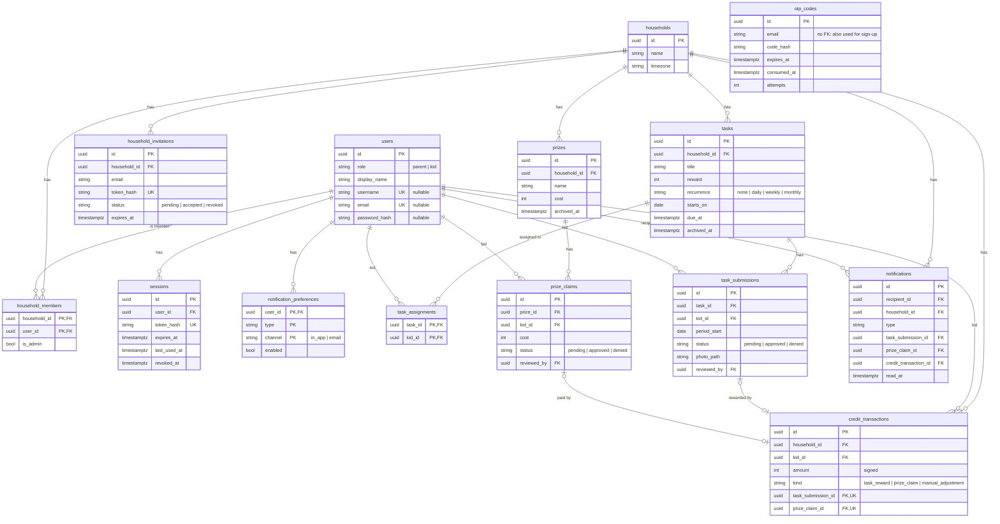

# Database model

This document explains how Capycoin stores its data and why it was designed this way. The code lives in `app-backend/models/` (SQLAlchemy 2.x models) and `app-backend/alembic/` (migrations). The database is PostgreSQL hosted on Supabase. Supabase is used only as a database, not for authentication or storage of business logic.

## Requirements this model covers

- A household has parents and kids. One parent is the household's admin.
- A user (parent or kid) can belong to more than one household.
- Parents log in with email (password or a one-time code). Kids may have no email and then log in with username and password.
- Parents invite other parents by email.
- Parents create tasks with a credit reward, assign them to specific kids, set deadlines, and make them repeat daily, weekly or monthly.
- A kid marks a task as done, optionally with a photo. A parent approves or denies it. Approval credits the kid's wallet.
- Parents manage a store of prizes. A kid claims a prize. A parent approves or denies it. Approval debits the wallet.
- Parents can add or remove credits by hand. A balance can go negative.
- Credits for pending prize claims are reserved, so a kid cannot spend the same credits twice.
- Parents and kids get notifications and can choose which ones they receive.
- Deleting a household deletes everything in it.

## Overview



The diagram leaves out `created_at`/`updated_at` and the "who did it" links (`created_by`, `invited_by`, `reviewed_by`), which all point to `users` and become null if that user is deleted.

### What gets deleted with what

```
households
├── household_members
├── household_invitations
├── tasks
│   ├── task_assignments
│   └── task_submissions
├── prizes
│   └── prize_claims
├── credit_transactions
└── notifications

users
├── household_members
├── sessions
├── notification_preferences
├── notifications (as recipient)
└── as a kid: task_assignments, task_submissions, prize_claims, credit_transactions
```

## How the main flows use the tables

```
TASK                                         PRIZE
kid marks done (+ optional photo)            kid claims prize (available balance >= cost)
  │                                            │
  ▼                                            ▼
task_submissions  status=pending             prize_claims  status=pending, cost copied
  │  notification to each parent               │  notification to each parent
  ▼                                            ▼
parent reviews (one DB transaction)          parent reviews (one DB transaction)
  ├─ approve: status=approved                  ├─ approve: status=approved
  │           credit_transactions +reward      │           credit_transactions -cost
  │           notification to kid              │           notification to kid
  └─ deny:    status=denied                    └─ deny:    status=denied
              notification to kid                          notification to kid
```

The parent's approval screen lists pending `task_submissions` and `prize_claims` directly. Notifications only tell people that something happened. They never hold approval state.

## Design decisions

### One `users` table for parents and kids

Parents and kids log in the same ways, receive notifications and have settings. Only their permissions differ, so they share one table with a `role` column. Database checks enforce the login rules:

- A parent must have an email (needed for one-time codes and invitations).
- A user without an email must have a username and a password.
- Emails and usernames are stored in lowercase, so uniqueness is case-insensitive. The application must lowercase them before saving.

### Membership is its own table

A user can be part of several households (for example, a kid with separated parents). `household_members` links users and households. The admin is a flag on the membership, and a partial unique index allows only one admin per household. The role stays on `users` because a person is a parent or a kid in every household they belong to.

### The wallet is an append-only log, one per kid per household

`credit_transactions` records every change to a kid's credits: task rewards (positive), prize claims (negative) and manual adjustments (either sign). A kid's balance is the sum of their rows in that household.

- **Per household:** each household sets its own rewards and prizes, so credits earned in one household cannot be spent in another.
- **Never updated or deleted:** a correction is a new `manual_adjustment` row. This gives the transaction history screen for free and keeps an audit trail.
- **Linked to its source:** a reward points to its submission and a prize payment to its claim. Unique constraints stop the same submission or claim from being paid twice. Checks make `kind`, sign and link agree.
- **Negative balances are allowed.** A parent can take away more credits than the kid has.
- **No stored balance column.** A family has few transactions, and a sum over an index is fast. A cached balance can be added later if needed.

**Reserved credits:** a pending claim's `cost` is reserved. The application allows a claim only when the available balance covers it:

```sql
-- balance
SELECT COALESCE(SUM(amount), 0) FROM credit_transactions
WHERE household_id = :household_id AND kid_id = :kid_id;

-- reserved
SELECT COALESCE(SUM(pc.cost), 0) FROM prize_claims pc
JOIN prizes p ON p.id = pc.prize_id
WHERE p.household_id = :household_id AND pc.kid_id = :kid_id AND pc.status = 'pending';

-- available = balance - reserved
```

To stop two requests from spending the same credits at the same time, any code that creates a claim or approves one must first lock the kid's membership row: `SELECT ... FROM household_members WHERE household_id = :h AND user_id = :kid FOR UPDATE`.

### Tasks, assignments and recurring tasks

- A task belongs to a household and is assigned to kids through `task_assignments`, one row per kid. Each kid does the task on their own. There are no shared tasks.
- `recurrence` is `none`, `daily`, `weekly` or `monthly`.
- `period_start` on a submission says which occurrence it is for: the start of the day, week or month for recurring tasks, and the task's `starts_on` for one-off tasks. A partial unique index allows one active (pending or approved) submission per kid, task and period. After a denial the kid can submit again.
- `due_at` is the deadline for a one-off task. For a recurring task it is when it stops repeating.
- `households.timezone` (an IANA name such as `Europe/Stockholm`) decides when a day, week or month starts.
- A submission's photo lives in object storage. The database stores only its path.

### Tasks and prizes are archived, not deleted

Deleting a task or prize would break the history that points to it. They have an `archived_at` column instead. The database enforces this for paid items: hard-deleting a task whose submission was rewarded fails, because the credit log still references it. Deleting a whole household still works, because everything in it is deleted together.

### Notifications

There is one row per recipient. A notification links to what it is about through one of three nullable foreign keys (submission, claim or credit transaction) instead of a generic "subject type + id" pair, so the database keeps the links valid. `notification_preferences` stores only the choices a user changed. A missing row means the default applies.

### Authentication is our own

Supabase Auth cannot log in with a username alone, and kids may have no email. The backend handles login itself: `users.password_hash` for passwords, `otp_codes` for one-time codes sent by email, and `sessions` for logged-in clients. Only hashes of passwords, codes, session tokens and invitation tokens are stored.

`otp_codes` is keyed by email, not by user, because a parent signs up by verifying a code before their account exists. It is not deleted with a user; codes expire within minutes. See [api.md](api.md) for how login and sessions work.

### Row Level Security on every table

Supabase publishes the `public` schema through its REST API. A migration enables RLS on every table with no policies and revokes access from Supabase's `anon` and `authenticated` roles. The backend connects as the table owner, which RLS does not apply to. **New tables must enable RLS in their migration** (`ALTER TABLE ... ENABLE ROW LEVEL SECURITY`); a test fails otherwise.

## Conventions

| Topic | Convention | Why |
|---|---|---|
| Primary keys | UUIDv7, generated in Python (`uuid.uuid7()`) | Ordered by time, so indexes stay efficient. IDs in URLs can't be guessed. |
| Timestamps | `timestamptz`, `created_at`/`updated_at` set by the database | No timezone mix-ups between servers and households. |
| Enums | `VARCHAR` + `CHECK`, storing lowercase values (`'pending'`) | Easier to change than native Postgres enums, and readable in SQL. |
| Credits | `integer` | Credits are whole numbers. |
| Constraint names | Fixed naming convention in `models/base.py` (`pk_`, `fk_`, `uq_`, `ck_`, `ix_`) | Migrations can refer to constraints by a stable name. |
| Model style | SQLAlchemy 2.x (`DeclarativeBase`, `Mapped[...]`, `mapped_column`) | Type checkers understand the models. |

## Rules the application must enforce

Some rules are hard to express as database constraints, so the backend code must check them:

- Only parents can be household admins.
- `kid_id` columns point to users with `role = 'kid'` who are members of the task's or prize's household.
- `reviewed_by` and `created_by` are parents of that household.
- A `credit_transactions.household_id` matches the household of its submission or claim.
- Claims and claim approvals check the available balance while holding the lock described above.
- Invitations are rejected after `expires_at`, and one-time codes after `expires_at` or too many `attempts`.

## Working with migrations

Run these from the repo root:

```bash
make be-db-up                                # start the local Postgres container (podman)
make be-migrate                              # apply all migrations (alembic upgrade head)
make be-test                                 # tests rebuild the schema in the capycoin_test database
```

For the local container, copy `.env.example` to `.env`. Tests always use the container's `capycoin_test` database, whatever `.env` says.

Create a new migration after changing a model, from `app-backend/`:

```bash
uv run alembic revision --autogenerate -m "short description"
uv run alembic upgrade head
```

Always read a generated migration before committing it. Autogenerate does not detect every change, for example changes to enum values or check constraints.

### First setup on the existing Supabase database

The database used before this model has tables with the old design, and one of them (`households`) has the same name as a new table. If its data is not needed, drop the old tables once before the first `make be-migrate`:

```sql
DROP TABLE IF EXISTS child_activities, parent_activities, children, parents, activities, households CASCADE;
DROP TYPE IF EXISTS activitystatus;
```

## Not covered yet

- Adding an existing kid without an email to a second household. Invitations work by email only.
- Push notifications for the installable web app. `notification_preferences.channel` can get a new value when that is added.
